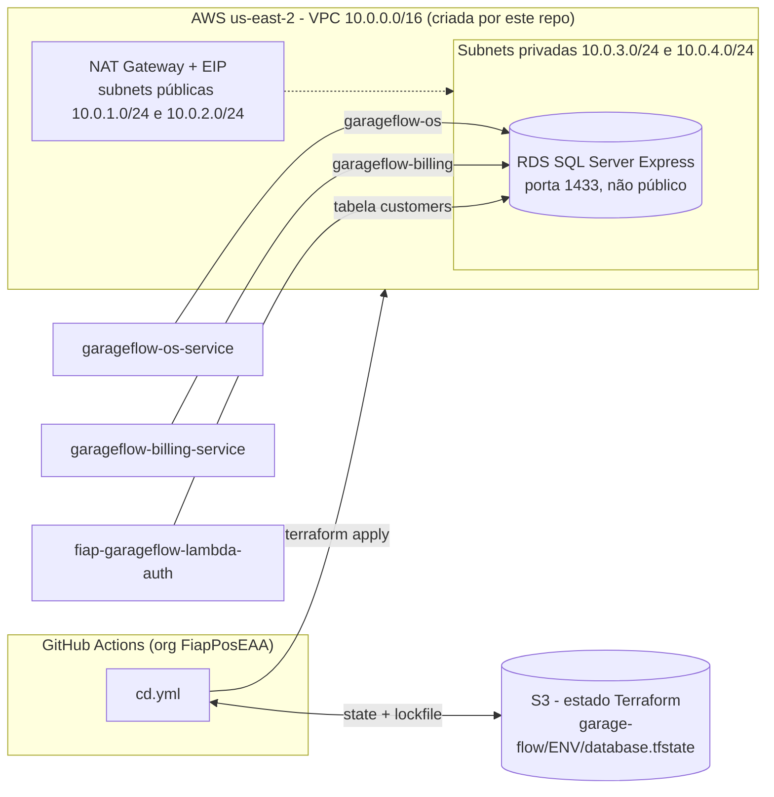

# fiap-garageflow-db-infra

Infraestrutura como código (Terraform) do banco de dados relacional do **GarageFlow**: uma instância **Amazon RDS for SQL Server (Express)** privada, junto com a rede (VPC, subnets, NAT) e o Security Group que a protegem.

Projeto do Tech Challenge Fase 4 (FIAP Pós Tech): a oficina mecânica, antes um monólito, foi refatorada em microsserviços (`os`, `billing`, `execution`) executados no EKS, na AWS (`us-east-2`), com deploy via GitHub Actions + Terraform.

## Sumário

- [Visão geral da solução](#visão-geral-da-solução)
- [O que este repositório provisiona](#o-que-este-repositório-provisiona)
- [Variáveis do Terraform](#variáveis-do-terraform)
- [Outputs](#outputs)
- [Estado remoto (S3)](#estado-remoto-s3)
- [Bancos lógicos por serviço](#bancos-lógicos-por-serviço)
- [Pipelines](#pipelines)
- [Como executar](#como-executar)
- [Dependências e ordem de deploy](#dependências-e-ordem-de-deploy)
- [Segurança](#segurança)
- [Custos e limpeza](#custos-e-limpeza)
- [Troubleshooting](#troubleshooting)
- [Status e pendências](#status-e-pendências)

## Visão geral da solução



### Repositórios da solução

Todos em `https://github.com/FiapPosEAA/<repo>`.

| Repositório | Papel |
|---|---|
| `fiap-garageflow-api` | Monólito legado (.NET) e documentação de arquitetura/ADR |
| `fiap-garageflow-db-infra` | **Este repo** - RDS SQL Server e rede |
| `fiap-garageflow-k8s-infra` | EKS, rede do cluster e IAM dos nodes |
| `fiap-garageflow-lambda-auth` | Lambda de autenticação por CPF + JWT e API Gateway |
| `garageflow-os-service` | Microsserviço de ordens de serviço; provisiona as filas SQS (workflow `Provision SQS`) |
| `garageflow-billing-service` | Microsserviço de faturamento |
| `garageflow-execution-service` | Microsserviço de execução; provisiona a tabela DynamoDB (workflow `Provision DynamoDB`) |
| `garageflow-ui` | Front-end |

## O que este repositório provisiona

Código em [terraform/](terraform/). Provider `hashicorp/aws` fixado em `6.54.0` ([providers.tf](terraform/providers.tf)).

| Recurso Terraform | Arquivo | Detalhes |
|---|---|---|
| `aws_vpc.garage_flow_vpc` | `main.tf` | CIDR `10.0.0.0/16`, DNS support e hostnames habilitados |
| `aws_internet_gateway.garage_flow_igw` | `main.tf` | IGW da VPC |
| `aws_subnet.garage_flow_subnet_az_a` / `_az_b` | `main.tf` | Públicas `10.0.1.0/24` (`<região>a`) e `10.0.2.0/24` (`<região>b`); IP público no launch; tags `kubernetes.io/cluster/garage_flow_eks` e `kubernetes.io/role/elb` |
| `aws_route_table.garage_flow_rt` + `aws_route_table_association.garage_flow_rta_az_a/_az_b` | `main.tf` | Rota `0.0.0.0/0` para o IGW nas subnets públicas |
| `aws_eip.garage_flow_nat_eip` | `main.tf` | EIP do NAT |
| `aws_nat_gateway.garage_flow_nat` | `main.tf` | NAT na subnet pública `az_a` |
| `aws_subnet.garage_flow_private_subnet_az_a` / `_az_b` | `main.tf` | Privadas `10.0.3.0/24` e `10.0.4.0/24`; tags `kubernetes.io/cluster/garage_flow_eks` e `kubernetes.io/role/internal-elb` |
| `aws_route_table.garage_flow_private_rt` + `aws_route_table_association.garage_flow_private_rta_az_a/_az_b` | `main.tf` | Rota `0.0.0.0/0` para o NAT nas subnets privadas |
| `aws_security_group.sql_server_sg` | `rds.tf` | Nome `garage-flow-sg`; ingress TCP `1433` a partir de `var.allowed_db_cidr_blocks`; egress total |
| `aws_db_subnet_group.sql_server` | `rds.tf` | Nome `garage-flow-db-subnets`, com as duas subnets privadas |
| `aws_db_instance.sql_server` | `rds.tf` | Engine `sqlserver-ex`, classe `db.t3.micro`, 20 GB, `publicly_accessible = false`, `skip_final_snapshot = true`, identificador = `var.sql_db_name` |

Observações do código:

- Vários recursos de rede usam `lifecycle { ignore_changes = [...] }` (tags, rotas ou `all` nas associações) e `try(...)` nas referências, o que faz o Terraform ignorar alterações feitas fora dele nesses atributos.
- [terraform/s3.tf](terraform/s3.tf) está **vazio**; o bucket de estado não é criado aqui.
- `engine_version` e `storage_encrypted` não são definidos em `aws_db_instance.sql_server` (valem os padrões do provider/AWS).
- Não há `db_name` na instância: nenhum banco lógico é criado pelo Terraform.

## Variáveis do Terraform

Definidas em [terraform/vars.tf](terraform/vars.tf).

| Variável | Tipo | Obrigatória | Padrão | Descrição |
|---|---|---|---|---|
| `aws_region` | string | Não | `us-east-2` | Região AWS (também usada para compor as AZs `<região>a`/`<região>b`) |
| `sql_db_name` | sem tipo explícito | Não | `garage-flow` | Usada como **identificador da instância RDS** (não cria banco lógico) |
| `sql_db_user` | sem tipo explícito | Não | `garage_flow` | Usuário master do RDS |
| `sql_db_password` | string, `sensitive` | **Sim** | - | Senha master do RDS |
| `allowed_db_cidr_blocks` | list(string) | Não | `["10.0.0.0/16"]` | CIDRs autorizados na porta 1433 |
| `cluster_name` | string | Não | `garageflow` | **Não é usada** por nenhum recurso (a descrição fala de um cluster `kind` local) |

## Outputs

Definidos em [terraform/outputs.tf](terraform/outputs.tf).

| Output | Valor |
|---|---|
| `sql_arn_id` | ARN da instância RDS |
| `sql_endpoint` | Endereço (hostname, sem porta) da instância RDS |

Não há outputs de VPC, subnets ou Security Group (veja [Status e pendências](#status-e-pendências)).

## Estado remoto (S3)

O backend é `backend "s3" {}` (vazio), configurado em tempo de `terraform init` por `-backend-config`:

| Parâmetro | Valor |
|---|---|
| `bucket` | Nome vindo do secret de organização `TF_STATE_BUCKET` |
| `key` | `garage-flow/<producao\|homologacao>/database.tfstate` |
| `region` | `AWS_REGION` (padrão `us-east-2`) |
| `encrypt` | `true` |
| `use_lockfile` | `true` (lock nativo do S3, requer Terraform >= 1.10) |

Terraform usado nos pipelines: **1.10.5**. O bucket precisa existir antes do primeiro `init` (ele não é criado por este repositório).

## Bancos lógicos por serviço

O Terraform cria **uma única instância RDS**. Cada microsserviço é dono de um banco lógico próprio nela:

| Consumidor | Banco lógico |
|---|---|
| `garageflow-os-service` | `garageflow-os` |
| `garageflow-billing-service` | `garageflow-billing` |
| `fiap-garageflow-lambda-auth` | banco informado em `DB_NAME`, com a tabela `customers` (colunas `id`, `name`, `document`, `isActive`) |

O serviço `garageflow-execution-service` usa DynamoDB e **não** usa este RDS.

Os bancos lógicos **não** são criados pelo Terraform. Como a instância é privada, crie-os a partir de um host dentro da VPC (ou com rota até ela), por exemplo com `sqlcmd`:

```sql
CREATE DATABASE [garageflow-os];
CREATE DATABASE [garageflow-billing];
```

Formato da connection string usada pelos serviços (os valores reais ficam em secrets do GitHub / Secret do Kubernetes, nunca no repositório):

```text
Server=<sql_endpoint>,1433;Database=garageflow-os;User Id=<sql_db_user>;Password=<SQL_DB_PASSWORD>;Encrypt=True;TrustServerCertificate=True;
```

## Pipelines

Workflows em [.github/workflows/](.github/workflows/).

### `ci.yml` - CI

- **Gatilhos:** `push` em `main`; `pull_request` para `main`.
- **Passos (job `validate`, diretório `terraform`):** `terraform fmt -check` -> `terraform init -backend=false` -> `terraform validate` (Terraform 1.10.5).
- **Secrets/Variables:** nenhum.

### `cd.yml` - CD Managed Database

- **Gatilhos:** `push` em `main` e `homologacao`; `workflow_dispatch`.
- **Ambiente GitHub:** `producao` se a branch é `main`; caso contrário `homologacao`.
- **Concorrência:** grupo `terraform-database-<branch>`.
- **Passos:** checkout -> `setup-terraform` 1.10.5 -> `configure-aws-credentials` -> `terraform init` (backend S3, chave `garage-flow/<env>/database.tfstate`) -> `terraform apply -auto-approve`. Não há passo de `plan` separado nem aprovação dentro do workflow (qualquer aprovação depende das regras de proteção do GitHub Environment).
- **Secrets (nomes):** `AWS_ACCESS_KEY_ID`, `AWS_SECRET_ACCESS_KEY`, `TF_STATE_BUCKET`, `SQL_DB_PASSWORD` (mapeado para `TF_VAR_sql_db_password`).
- **Variables:** `AWS_REGION` (opcional; padrão `us-east-2`).

### `terraform-reset.yml` - Terraform Reset

- **Gatilho:** somente `workflow_dispatch`, com input `environment` (`homologacao` padrão, ou `producao`).
- **Ambiente GitHub:** o escolhido no input.
- **Passos:** checkout -> Terraform 1.10.5 -> credenciais AWS -> `bash ../scripts/reset-non-default-vpcs.sh --force` -> `terraform init` (mesmo backend, chave `garage-flow/<env>/database.tfstate`) -> `terraform plan -destroy` -> `terraform destroy -auto-approve`.
- **Secrets/Variables:** os mesmos do `cd.yml`.
- **ATENÇÃO:** o script é destrutivo e **não é restrito a este repositório** (veja [Custos e limpeza](#custos-e-limpeza)).

## Como executar

### Via pipeline

1. Configure os secrets `AWS_ACCESS_KEY_ID`, `AWS_SECRET_ACCESS_KEY` e `TF_STATE_BUCKET` (organização) e `SQL_DB_PASSWORD` (repositório ou ambiente), e, se necessário, a variable `AWS_REGION`.
2. Crie os GitHub Environments `homologacao` e `producao`.
3. Faça push em `homologacao` ou `main` (ou rode `CD Managed Database` manualmente).
4. Anote o endpoint do RDS (veja abaixo) e crie os bancos lógicos.

### Localmente

Pré-requisitos: Terraform >= 1.10, AWS CLI configurada e acesso ao bucket de estado.

```bash
aws sts get-caller-identity

cd terraform
export TF_VAR_sql_db_password="<senha-forte>"   # nunca commitar

terraform init \
  -backend-config="bucket=<TF_STATE_BUCKET>" \
  -backend-config="key=garage-flow/homologacao/database.tfstate" \
  -backend-config="region=us-east-2" \
  -backend-config="encrypt=true" \
  -backend-config="use_lockfile=true"

terraform fmt -check
terraform validate
terraform plan
terraform apply

terraform output -raw sql_endpoint
```

Para apenas validar sem acessar o estado: `terraform init -backend=false && terraform validate`.

## Dependências e ordem de deploy

Ordem recomendada da solução: **db-infra** -> k8s-infra -> lambda-auth -> SQS -> DynamoDB -> serviços.

- Este é o primeiro repositório da cadeia; não depende de nenhum outro.
- Entregas esperadas por quem vem depois: `sql_endpoint` (serviços `os` e `billing`, Lambda) e a criação manual dos bancos `garageflow-os` e `garageflow-billing`.
- A Lambda de autenticação precisa de subnets/Security Group com rota até o RDS. As subnets privadas daqui (`10.0.3.0/24`, `10.0.4.0/24`) e o ingress padrão `10.0.0.0/16` na 1433 atendem a esse caso.
- **Atenção à rede:** `fiap-garageflow-k8s-infra` declara uma VPC com o mesmo CIDR (`10.0.0.0/16`) e os mesmos nomes de recursos, mas com **estado separado** (`k8s.tfstate`). Veja [Status e pendências](#status-e-pendências).

## Segurança

- **Menor privilégio de rede:** o RDS não é público e só aceita 1433 dos CIDRs em `allowed_db_cidr_blocks` (padrão: a própria VPC). Prefira restringir a CIDRs/SGs específicos.
- **Segredos:** a senha vem de `TF_VAR_sql_db_password` / secret `SQL_DB_PASSWORD`; nunca a grave em `vars.tf` ou `.tfvars` versionados. A senha é `sensitive` na saída do Terraform, mas **fica no arquivo de estado** - o bucket de estado deve ter acesso restrito, versionamento e criptografia (`encrypt=true` é usado no backend).
- **Credenciais AWS dos pipelines:** chaves de acesso de longa duração (`AWS_ACCESS_KEY_ID`/`AWS_SECRET_ACCESS_KEY`) em secrets de organização. O usuário IAM correspondente deve ter apenas as permissões necessárias (VPC/EC2, RDS e acesso ao bucket de estado). Não há OIDC configurado nos workflows.
- **SCP:** a conta da disciplina pode ter SCP que bloqueia o login no console IAM; nesse caso use somente CLI/chaves de acesso e não dependa do console para criar/rotacionar usuários e políticas.
- **Criptografia em repouso:** `storage_encrypted` não está definido na instância RDS.
- **TLS:** os serviços usam `Encrypt=True;TrustServerCertificate=True`, o que cifra o canal mas não valida o certificado do servidor.

## Custos e limpeza

Itens que geram custo enquanto existirem: NAT Gateway e EIP, instância RDS `db.t3.micro` com 20 GB e tráfego de saída. Faça a limpeza ao fim das avaliações.

### Destruir apenas os recursos deste repositório

Com o state correto, localmente:

```bash
cd terraform
export TF_VAR_sql_db_password="<senha>"
terraform init -backend-config="bucket=<TF_STATE_BUCKET>" -backend-config="key=garage-flow/<env>/database.tfstate" -backend-config="region=us-east-2" -backend-config="encrypt=true" -backend-config="use_lockfile=true"
terraform plan -destroy
terraform destroy
```

Antes, remova recursos de outros repositórios que dependam da VPC/RDS (a ordem inversa do deploy: serviços -> DynamoDB -> SQS -> lambda-auth -> k8s-infra -> db-infra). Como `skip_final_snapshot = true`, **não haverá snapshot final** do RDS.

### Workflow `Terraform Reset` (uso extremo)

Executa [scripts/reset-non-default-vpcs.sh](scripts/reset-non-default-vpcs.sh) `--force` e depois `terraform destroy`. Pelo código, o script atua na região configurada (`AWS_REGION`), em **toda a conta**, e não apenas nos recursos deste repo:

- apaga **todas** as instâncias RDS (sem snapshot final, incluindo backups automáticos) e todos os DB subnet groups não `default`;
- esvazia (inclusive versões) e **apaga todos os buckets S3** que estejam na região - o que inclui o bucket de estado do Terraform, se ele estiver na mesma região; como o `terraform init` roda depois do script, o init/destroy subsequente pode falhar e o histórico de estado se perde;
- termina instâncias EC2, apaga load balancers, VPC endpoints, NAT gateways, IGWs, ENIs disponíveis, subnets, NACLs, Security Groups, route tables e **todas as VPCs não default** (inclusive a do EKS, se não houver dependências bloqueando) e libera **todos** os EIPs.

Ele não remove clusters EKS, Lambda, API Gateway, IAM, SQS nem DynamoDB. Use apenas em conta descartável e com os demais componentes já removidos.

## Troubleshooting

1. **`terraform output -raw sql_endpoint` não retorna nada.** O diretório está usando outro state (ou nenhum). Rode `terraform init` com o `key` correto (`garage-flow/<env>/database.tfstate`) ou consulte o endpoint em RDS > Databases > Connectivity & security.
2. **`terraform init` falha com `NoSuchBucket`/`AccessDenied`.** O bucket em `TF_STATE_BUCKET` não existe, está em outra região ou o usuário não tem acesso. Confirme `aws s3 ls s3://<TF_STATE_BUCKET>` e a região (`-backend-config="region=..."`).
3. **Erro `Error acquiring the state lock`.** Uma execução anterior foi interrompida e deixou o lockfile (`.tflock`) no S3. Confirme que não há outro job em andamento e, só então, use `terraform force-unlock <LOCK_ID>`.
4. **Serviço/Lambda não conecta ao RDS (timeout).** O RDS está em subnets privadas e a porta 1433 só aceita `allowed_db_cidr_blocks`. Verifique se o cliente está na mesma VPC (ou em rede com rota) e se o CIDR dele está liberado. Pods do EKS criados pelo repo `k8s-infra` estão em **outra VPC** (veja pendências).
5. **`Cannot open database "garageflow-os" requested by the login`.** O Terraform não cria os bancos lógicos; execute os `CREATE DATABASE` descritos acima.
6. **`terraform apply` pede `sql_db_password`.** A variável não tem default; defina `TF_VAR_sql_db_password` ou o secret `SQL_DB_PASSWORD` no ambiente do GitHub.

## Status e pendências

Verificado nos arquivos `.tf`, workflows e script deste repositório (e em referências cruzadas nos repositórios irmãos):

- [x] Rede (VPC, subnets públicas/privadas, IGW, NAT), Security Group e RDS SQL Server Express definidos em Terraform.
- [x] CI (`fmt`, `init -backend=false`, `validate`) e CD (`apply -auto-approve`) por ambiente `producao`/`homologacao`.
- [x] Backend S3 com `encrypt` e `use_lockfile`, chave por ambiente.
- [x] Workflow de reset/destroy disponível (`Terraform Reset`).
- [ ] **VPC duplicada com `fiap-garageflow-k8s-infra`:** os dois repositórios criam uma VPC `10.0.0.0/16` com os mesmos nomes de recursos, em states diferentes (`database.tfstate` e `k8s.tfstate`). Pelo código, o EKS ficará em uma VPC e o RDS em outra, ambas com o mesmo CIDR (sem possibilidade de VPC peering por sobreposição) e com dois NAT Gateways. Falta decidir uma VPC única (ex.: remote state/data source compartilhado). Não foi verificado o que existe hoje na conta AWS.
- [ ] Sem outputs de `vpc_id`, subnets e Security Group: `LAMBDA_SUBNET_IDS` e `LAMBDA_SECURITY_GROUP_IDS` do repo `lambda-auth` precisam ser obtidos manualmente.
- [ ] Bancos lógicos `garageflow-os` e `garageflow-billing` criados manualmente (sem automação nos repositórios lidos); a tabela `customers` consumida pela Lambda não pertence a nenhum desses bancos nos microsserviços (o `OsDbContext` só mapeia `WorkOrders` e `OutboxMessages`).
- [ ] `terraform/s3.tf` vazio e variável `cluster_name` (descrição sobre `kind`) sem uso: resíduos a limpar.
- [ ] Nomes fixos (`garage-flow-sg`, `garage-flow-db-subnets`, identificador `garage-flow`): `homologacao` e `producao` na mesma conta/região colidiriam, pois só o state muda entre ambientes.
- [ ] `storage_encrypted`, `engine_version`, retenção de backup e `deletion_protection` não definidos; `skip_final_snapshot = true`.
- [ ] README anterior citava Terraform 1.8+; os pipelines usam 1.10.5 e `use_lockfile` exige >= 1.10.
- [ ] O secret da senha aqui é `SQL_DB_PASSWORD`, mas `k8s-infra` e `lambda-auth` usam `DB_PASSWORD` (presumivelmente o mesmo valor, com nome diferente), e `docs/operations.md` do repo `fiap-garageflow-api` não lista `SQL_DB_PASSWORD` nem `TF_STATE_BUCKET`.
- [ ] Workflow `Terraform Reset` apaga recursos de toda a região da conta (incluindo buckets S3), não só os deste repo.
- [ ] Não há `.gitignore` neste repositório (ex.: `.terraform/`, `*.tfstate`).
- [ ] CI não roda em push de `homologacao` (só `main` e PRs para `main`).
